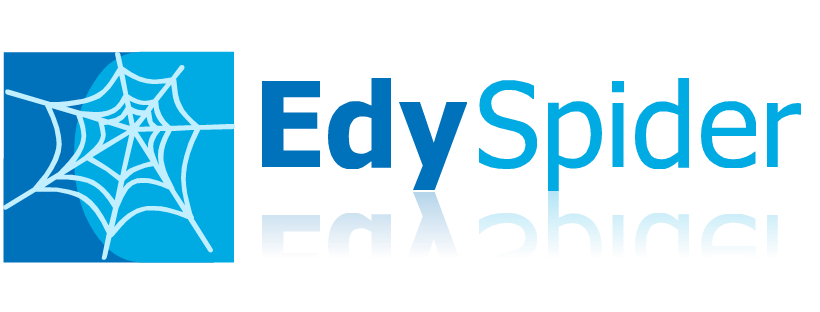

# EdySpider

 &nbsp;
 &nbsp;
 &nbsp;

## 👋 About me

Developer based in Portugal, focused on **Dynamics 365 Business Central (AL)**, **PHP/Laravel** and **TypeScript**.
I build VS Code extensions and npm packages that simplify day-to-day development and the validation of Portuguese fiscal data.

## 🛠️ Tech stack

   

   
   

## 🚀 Featured projects

| Project | Description |
| --- | --- |
| 🌐 [edyspider.com](https://edyspider.com/) | My personal portfolio and a set of online validation tools. Built with an API-first approach: clear separation between the web layer, services and the public/private API, with isolated, reusable business logic ready for integration with external or mobile applications |
| 🗂️ [ALStructureCreator](https://github.com/edyspider/ALStructureCreator) | Creates the folder structure for AL projects |
| 🧾 [validate-nif](https://github.com/edyspider/validate-nif) | npm package to validate Portuguese NIF numbers ([`@edyspider/validate-nif`](https://www.npmjs.com/package/@edyspider/validate-nif)) |
| 🛡️ [validate-niss](https://github.com/edyspider/validate-niss) | npm package to validate Portuguese NISS (social security) numbers |
| 🏦 [validate-bank-account-pt](https://github.com/edyspider/validate-bank-account-pt) | Portuguese bank account number validator |
| 🚀 [ALLaunchManagement](https://github.com/edyspider/ALLaunchManagement) | Manage multiple launch configurations in AL projects |
| 📦 [ALExtensionPack](https://github.com/edyspider/ALExtensionPack) | AL extension pack for VS Code |
| 🧩 [LaraExtensionPack](https://github.com/edyspider/LaraExtensionPack) | PHP Laravel extension pack for VS Code |
| 📁 [VSCodeProjectFolderManagement](https://github.com/edyspider/VSCodeProjectFolderManagement) | Project folder management for VS Code |

## 📊 Stats

   
   
   

## 📫 Contact

- LinkedIn: [ederlealsilva](https://www.linkedin.com/in/ederlealsilva/)
- Dev.to: [edyspider](https://dev.to/edyspider)
- npm: [edyspider](https://www.npmjs.com/~edyspider)
